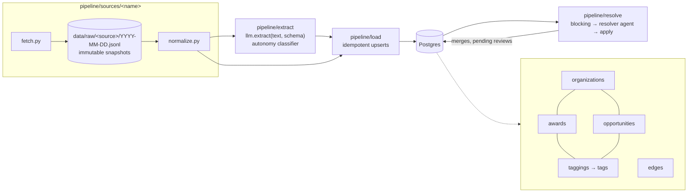

# flock

A pipeline and knowledge graph tracking US defense funding for autonomy and
drones. It covers both sides of the market:

- **Demand**: solicitations, BAAs, and topics (`opportunities`)
- **Supply**: obligated contract awards (`awards`)

Both link to `organizations` (companies, agencies, offices). An LLM classifier
tags them with an autonomy taxonomy, and they're connected through typed
`edges`. An entity-resolution agent finds organization rows that are the same
company under different names and merges them.

## Architecture



Every source works the same way:

1. **fetch** pulls from the upstream API politely (descriptive User-Agent,
   backoff on 429/5xx, one request at a time per host) and writes an
   append-only raw snapshot to `data/raw/<source>/<YYYY-MM-DD>.jsonl`.
2. **normalize** turns raw records into Pydantic models that mirror the
   schema. It's a pure function, so it's testable against recorded fixtures.
3. **load** upserts into Postgres with `ON CONFLICT (source, source_id)`.
   Re-running a load is a no-op.

Every row carries `source`, `source_id`, and `fetched_at` for provenance.

After loading, two steps run over what is already in Postgres: the autonomy
classifier, then entity resolution. See
[Where agents are used and why](#where-agents-are-used-and-why).

## Sources

| Source | What | Notes |
| --- | --- | --- |
| `usaspending` | DoD contract awards matching `config/keywords.yaml` | No key. DoD data is published ~90 days after signing, so we look back 180 days nightly and let idempotent upserts pick up late records. |
| `dod_contracts` | Daily DoD contract announcements (≥ $7.5M), split into paragraphs and extracted with `llm.extract` | New days are found via the war.gov RSS feed. Article pages return 403 (Akamai) to non-browser clients, so pages come from (1) a polite direct fetch, (2) Bright Data Web Unlocker **only if** `BRIGHTDATA_API_KEY` + `BRIGHTDATA_ZONE` are set, or (3) HTML saved from a browser into `data/inbox/dod_contracts/`. The raw paragraph is stored next to its extraction (`awards.raw_text`, `awards.extraction`). |

### Fetching policy

All fetches go through `pipeline.http.PoliteClient`: a descriptive
User-Agent, one request at a time per host, and backoff on 429/5xx. The one
deliberate exception is the opt-in Bright Data fallback for war.gov article
pages. It goes around DoD's bot protection, so it stays off unless an
operator sets both secrets. Volume is about one page per weekday.

## Layout

```
pipeline/
  sources/<name>/{fetch.py, normalize.py}   one folder per source
  extract/                                  LLM extraction + autonomy classifier
  resolve/                                  entity resolution: blocking, agent, tools, apply, CLI
  agents/                                   shared agent infra: settings, budgets, run log, tracing
  load/                                     Postgres upserts
  db.py                                     connection + migration runner
scripts/eval_resolver.py                    manual resolver eval (live calls)
data/raw/<source>/<YYYY-MM-DD>.jsonl        immutable raw snapshots
migrations/                                 plain SQL, applied in order
config/                                     keyword lists, taxonomy
tests/                                      unit tests on recorded fixtures
.github/workflows/                          scheduled runs
```

## Setup

```sh
uv sync
cp .env.example .env    # then fill in the values below
uv run --env-file .env python -m pipeline.db    # apply migrations
```

Pass `--env-file .env` to `uv run` for every pipeline command: `DATABASE_URL`
and a few other values are read straight from the process environment.

| Variable | Needed for | Notes |
| --- | --- | --- |
| `DATABASE_URL` | everything | Postgres connection string |
| `GEMINI_API_KEY` | extraction, classifier, resolver | |
| `SAM_API_KEY` | resolver's SAM.gov lookups | Optional. Without it that tool reports "unavailable" and the agent works from USAspending and our own data. |
| `SAM_DAILY_QUOTA` | SAM.gov request cap | Default `10` (personal key, no role). Set `1000` for a key with a role or a system account. |
| `EXTRACT_MODEL`, `RESOLVE_MODEL` | model choice | Bare Gemini model names. Defaults are in `pipeline/config.py`. |
| `LOGFIRE_TOKEN` | tracing | Optional. Also needs `uv sync --group observability`. |

`.env.example` lists the rest (budgets, `FLOCK_CONTACT`, Bright Data).

## Where agents are used and why

The pipeline is deterministic by default. An LLM is used only where the input
is prose or the question needs judgment, and only one step is an agent.

| Step | Kind | Why |
| --- | --- | --- |
| Fetch, normalize, load | Plain Python | Structured inputs. Must be reproducible and testable on fixtures. |
| DoD announcement extraction (`llm.extract`) | Single LLM call, structured output | The source is a prose paragraph. No tools. |
| Autonomy classifier | Single LLM call, structured output | Judging what is being bought needs reading. No tools. Tags are a `Literal` built from `config/taxonomy.yaml`, so the model can't invent one. |
| Candidate blocking, UEI auto-merge, address comparison | Plain Python | Cheap and exact. They decide what the agent sees and give it facts to lean on. |
| **Entity resolution** | **Agent with tools** | Two similar names can be one company, a parent and its subsidiary, or a joint venture. Telling them apart needs lookups, and which lookups depends on what the first one returns. |
| Applying merges, undo | Plain Python | Only `pipeline/resolve/apply.py` writes merges, and only after the agent has returned. |

All LLM calls go through [Pydantic AI](https://ai.pydantic.dev/). Extraction
and classification are not agentic: one request, and one retry if the output
is invalid or a validator rejects it (a negative amount, a contract number
that doesn't look like one, a blank rationale). After that the call fails and
the record is skipped for the night.

### Budgets

Budgets are defined in one place, `pipeline/agents/budgets.py`, from settings
in `pipeline/agents/settings.py`.

| Setting | Default | Applies to |
| --- | ---: | --- |
| `EXTRACT_REQUEST_LIMIT` | 2 | Model requests per extraction or classification |
| `RESOLVE_REQUEST_LIMIT` | 10 | Model requests per resolver decision |
| `RESOLVE_TOOL_CALLS_LIMIT` | 8 | Tool calls per resolver decision |
| `RESOLVE_TOTAL_TOKENS_LIMIT` | 50000 | Input + output tokens per resolver decision |

A run that hits a limit stops. It is recorded in `agent_runs` with status
`failed`, and nothing is applied for that pair or record. The pair is
proposed again on the next run.

### How the resolver decides

1. **Blocking** (`candidates.py`, no LLM). Company rows that share a UEI are
   merged straight away without the agent. Other rows are paired when their
   normalized names are similar (legal suffixes, punctuation and case
   stripped), or when one name is the other plus a division, the way DoD
   announcements write "Lockheed Martin Corp., Missiles and Fire Control".
   `--limit` caps the pairs per run.
2. **The agent** (`agent.py`) gets one pair and four read-only tools:
   `lookup_sam_entity` (SAM.gov: legal name, DBA, CAGE, address, parents),
   `search_usaspending_recipient` (parent/child links, former names),
   `get_org_awards` (what we already hold for an org), and
   `compare_addresses` (deterministic). It returns a `MergeDecision`:
   `merge`, `separate` or `unsure`, a confidence, and evidence.
3. **Apply** (`apply.py`):

| Decision | Confidence | Result |
| --- | --- | --- |
| `merge` | ≥ 0.9 | Merged now. Recorded in `org_merges` with a snapshot for undo. |
| `separate` | ≥ 0.9 | Recorded in `org_non_matches`. The pair is never asked again. |
| anything else | | Queued in `pending_merges` for you to review. |

"Merge" means the same legal entity under different spellings: a DBA, a
former name, or a division name written after the company. A parent and its
subsidiary are separate legal entities and stay separate. So do sibling
subsidiaries and joint ventures, even when a venture carries a partner's name.

A merge keeps both rows. The merged row gets `merged_into` set, its name and
aliases move to the surviving row, and its awards, edges and taggings are
repointed. Loaders follow `merged_into`, so the next nightly load doesn't
undo the merge.

### Reviewing merges

```sh
# One pass. --dry-run still calls the model (it costs tokens) but merges nothing.
uv run --env-file .env python -m pipeline.resolve run --limit 50 --dry-run
uv run --env-file .env python -m pipeline.resolve run --limit 50

# Go through pending merges: accept / reject / skip / quit.
uv run --env-file .env python -m pipeline.resolve review
uv run --env-file .env python -m pipeline.resolve review --list
uv run --env-file .env python -m pipeline.resolve review --accept 12 [--canonical ORG_ID]
uv run --env-file .env python -m pipeline.resolve review --reject 12

# Find a merge and reverse it.
uv run --env-file .env python -m pipeline.resolve merges
uv run --env-file .env python -m pipeline.resolve undo 7
```

- **Accept** means "these are the same organization": they are merged,
  whatever the agent proposed. If the agent didn't name a surviving row, you
  are asked which one to keep (or pass `--canonical`).
- **Reject** means "different organizations". The pair is recorded as a
  non-match and not asked again.
- **Undo** restores both rows from the snapshot and records the pair as a
  non-match, so the next run doesn't redo the merge. Undo newest first: it
  refuses while a later merge still touches either row.

`run` exits 2 when every pair sent to the agent failed. `review --accept`,
`--reject` and `undo` exit 1 when the action is refused.

### Audit trail and cost

Every LLM call writes one row to `agent_runs`: agent name (`extract:<Schema>`,
`classifier`, `resolver`), what it ran on, model, status, requests, input and
output tokens, the tool calls made, the output, and any error. API keys are
redacted before anything is stored. Tokens per agent per day:

```sql
SELECT started_at::date AS day, agent_name, count(*) AS runs,
       sum(input_tokens) AS input_tokens, sum(output_tokens) AS output_tokens,
       count(*) FILTER (WHERE status = 'failed') AS failed
FROM agent_runs
GROUP BY 1, 2
ORDER BY 1 DESC, 2;
```

The resolver's SAM.gov and USAspending responses are cached in `http_cache`
(30 days for answers, 1 hour for errors). SAM.gov documents no quota error,
so the pipeline counts its own requests per UTC day from that table and stops
calling SAM once `SAM_DAILY_QUOTA` is reached. Cache hits don't count.

Logfire tracing is optional. Run `uv sync --group observability` and set
`LOGFIRE_TOKEN`. Without the token nothing is configured or sent.

### Resolver eval

`tests/evals/resolve/pairs.yaml` holds hand-labeled pairs. Right now it has
**5 placeholders marked `todo: true`**, written from general knowledge. Replace
them with about 20 real pairs before trusting the numbers. See
`tests/evals/resolve/README.md`.

```sh
uv run --env-file .env python scripts/eval_resolver.py [--limit N] [--json]
```

It calls the real model, so it is manual only and never runs in CI. It
reports accuracy, precision and recall on "merge", and average requests, tool
calls and tokens per decision. It never applies a decision.

### Known limitations

- **Not yet run live.** The Gemini and SAM.gov paths are tested against
  scripted models and fixtures only. The SAM.gov fixture is built from the
  API documentation, not recorded; re-record it once a key exists
  (`tests/fixtures/resolve/README.md`). The USAspending fixtures are real.
- **No cost figure yet.** Scripted tests don't count the instructions or tool
  schemas, so they understate tokens. A `run --dry-run` prints per-decision
  averages; use that.
- **Blocking is by the first word of the normalized name.** Duplicates whose
  names start differently ("Sikorsky Aircraft" vs "Lockheed Martin Sikorsky")
  are never proposed.
- **`same_state` is usually unknown.** Organizations have no address column.
  A state is known only for companies seen in DoD announcements.
- **Undo leaves one trace.** An award first loaded while a merge was active
  keeps its `awarded_to` edge on the surviving row after an undo. The next
  load moves `recipient_id` back, but not that edge.

## Development

```sh
uv run ruff check . && uv run ruff format --check .
uv run pytest
```

Database tests run against a throwaway embedded Postgres (`pgserver`, a dev
dependency), or against `TEST_DATABASE_URL` if you set it. They never read
`DATABASE_URL`. Tests never make live network calls; ingestors are tested
against recorded fixtures in `tests/fixtures/`.

## Scheduled runs

`.github/workflows/nightly.yml` runs daily at 09:00 UTC (and on manual
dispatch): migrate → USAspending → DoD announcements → classifier → resolve.
It writes a job summary with new-row counts per step, table totals, and a
resolution section (runs, merges, pending, tokens, failed runs), and uploads
`data/raw/` as a 90-day artifact. USAspending and the classifier are
required. The DoD step is non-blocking because its pages are usually 403.
The resolve step is non-blocking too: it is new and SAM.gov access is
optional.

Repository **secrets**:

| Secret | Required | Purpose |
| --- | --- | --- |
| `DATABASE_URL` | yes | Postgres connection string |
| `GEMINI_API_KEY` | yes | DoD extraction, the classifier and the resolver agent |
| `BRIGHTDATA_API_KEY`, `BRIGHTDATA_ZONE` | no | Opt-in unlocker for war.gov article pages |
| `SAM_API_KEY` | no | SAM.gov Entity API lookups for the resolver; without it the agent uses USAspending and our own data |
| `LOGFIRE_TOKEN` | no | Sends agent traces to Logfire; nothing is sent when unset |

Optional repository **variables**:

| Variable | Default | Purpose |
| --- | --- | --- |
| `FLOCK_CONTACT` | none | Appended to the User-Agent |
| `EXTRACT_MODEL` | `gemini-3.8-flash` | Gemini model for extraction and the classifier |
| `RESOLVE_MODEL` | `gemini-3.8-flash` | Gemini model for the resolver agent |
| `RESOLVE_LIMIT` | `25` | Max organization pairs sent to the resolver per night |
| `SAM_DAILY_QUOTA` | `10` | SAM.gov requests allowed per UTC day: 10 for a personal key with no role, 1000 with a role or a system account |

`.github/workflows/ci.yml` runs ruff and pytest against a Postgres service
container on every push and PR.
