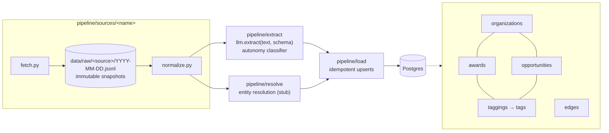

# flock

A pipeline and knowledge graph tracking US defense funding for autonomy and
drones. It covers both sides of the market:

- **Demand**: solicitations, BAAs, and topics (`opportunities`)
- **Supply**: obligated contract awards (`awards`)

Both link to `organizations` (companies, agencies, offices). An LLM classifier
tags them with an autonomy taxonomy, and they're connected through typed
`edges`.

## Architecture



Every source works the same way:

1. **fetch** pulls from the upstream API politely (descriptive User-Agent,
   backoff on 429/5xx, one request at a time per host) and writes an
   append-only raw snapshot to `data/raw/<source>/<YYYY-MM-DD>.jsonl`.
2. **normalize** turns raw records into Pydantic models that mirror the
   schema. It's a pure function, so it's testable against recorded fixtures.
3. **load** upserts into Postgres with `ON CONFLICT (source, source_id)`.
   Re-running a load is a no-op.

Every row carries `source`, `source_id`, and `fetched_at` for provenance.

## Layout

```
pipeline/
  sources/<name>/{fetch.py, normalize.py}   one folder per source
  extract/                                  LLM extraction + autonomy classifier
  resolve/                                  entity resolution (stub)
  load/                                     Postgres upserts
  db.py                                     connection + migration runner
data/raw/<source>/<YYYY-MM-DD>.jsonl        immutable raw snapshots
migrations/                                 plain SQL, applied in order
config/                                     keyword lists, taxonomy
tests/                                      unit tests on recorded fixtures
.github/workflows/                          scheduled runs
```

## Setup

```sh
uv sync
cp .env.example .env    # then fill in DATABASE_URL, GEMINI_API_KEY
uv run python -m pipeline.db    # apply migrations
```

## Development

```sh
uv run ruff check . && uv run ruff format --check .
uv run pytest
```

Database tests run against a throwaway embedded Postgres (`pgserver`, a dev
dependency), or against `TEST_DATABASE_URL` if you set it. They never read
`DATABASE_URL`. Tests never make live network calls; ingestors are tested
against recorded fixtures in `tests/fixtures/`.
