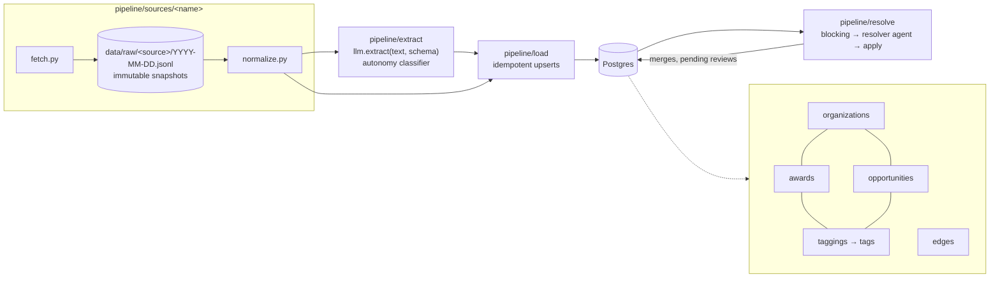

# flock

A pipeline and knowledge graph tracking US defense funding for autonomy and
drones. It covers both sides of the market:

- **Demand**: solicitations, BAAs, and topics (`opportunities`)
- **Supply**: obligated contract awards (`awards`)

Both link to `organizations` (companies, agencies, offices). An LLM classifier
tags them with an autonomy taxonomy, and they're connected through typed
`edges`. An entity-resolution agent finds organization rows that are the same
company under different names and merges them.

## Architecture



Every source works the same way:

1. **fetch** pulls from the upstream API politely (descriptive User-Agent,
   backoff on 429/5xx, one request at a time per host) and writes an
   append-only raw snapshot to `data/raw/<source>/<YYYY-MM-DD>.jsonl`.
2. **normalize** turns raw records into Pydantic models that mirror the
   schema. It's a pure function, so it's testable against recorded fixtures.
3. **load** upserts into Postgres with `ON CONFLICT (source, source_id)`.
   Re-running a load is a no-op.

Every row carries `source`, `source_id`, and `fetched_at` for provenance.

After loading, two steps run over what is already in Postgres: the autonomy
classifier, then entity resolution. See
[Where agents are used and why](#where-agents-are-used-and-why).

## Sources

| Source | What | Notes |
| --- | --- | --- |
| `usaspending` | DoD contract awards matching `config/keywords.yaml` | No key. DoD data is published ~90 days after signing, so we look back 180 days nightly and let idempotent upserts pick up late records. |
| `dod_contracts` | Daily DoD contract announcements (≥ $7.5M), split into paragraphs and extracted with `llm.extract` | New days are found via the war.gov RSS feed. Article pages return 403 (Akamai) to non-browser clients, so pages come from (1) a polite direct fetch, (2) Bright Data Web Unlocker **only if** `BRIGHTDATA_API_KEY` + `BRIGHTDATA_ZONE` are set, or (3) HTML saved from a browser into `data/inbox/dod_contracts/`. The raw paragraph is stored next to its extraction (`awards.raw_text`, `awards.extraction`). |

### Fetching policy

All fetches go through `pipeline.http.PoliteClient`: a descriptive
User-Agent, one request at a time per host, and backoff on 429/5xx. The one
deliberate exception is the opt-in Bright Data fallback for war.gov article
pages. It goes around DoD's bot protection, so it stays off unless an
operator sets both secrets. Volume is about one page per weekday.

## Layout

```
pipeline/
  sources/<name>/{fetch.py, normalize.py}   one folder per source
  extract/                                  LLM extraction + autonomy classifier
  resolve/                                  entity resolution: blocking, agent, tools, apply, CLI
  agents/                                   shared agent infra: settings, budgets, run log, tracing
  load/                                     Postgres upserts
  api/                                      read-only FastAPI service for the web UI, dev seed
  db.py                                     connection + migration runner
scripts/eval_resolver.py                    manual resolver eval (live calls)
data/raw/<source>/<YYYY-MM-DD>.jsonl        immutable raw snapshots
migrations/                                 plain SQL, applied in order
config/                                     keyword lists, taxonomy
web/                                        Next.js site (landing, graph, entity pages, field report)
tests/                                      unit tests on recorded fixtures
.github/workflows/                          scheduled runs
```

## Setup

```sh
uv sync
cp .env.example .env    # then fill in the values below
uv run --env-file .env python -m pipeline.db    # apply migrations
```

Pass `--env-file .env` to `uv run` for every pipeline command: `DATABASE_URL`
and a few other values are read straight from the process environment.

| Variable | Needed for | Notes |
| --- | --- | --- |
| `DATABASE_URL` | everything | Postgres connection string |
| `ANTHROPIC_API_KEY` | extraction, classifier, resolver | The default models are Claude. |
| `GEMINI_API_KEY` | the same three steps, on Gemini | Optional. Only needed when a model variable names a Gemini model. |
| `SAM_API_KEY` | resolver's SAM.gov lookups | Optional. Without it that tool reports "unavailable" and the agent works from USAspending and our own data. |
| `SAM_DAILY_QUOTA` | SAM.gov request cap | Default `10` (personal key, no role). Set `1000` for a key with a role or a system account. |
| `EXTRACT_MODEL`, `RESOLVE_MODEL` | model choice | `<provider>:<model>`. Defaults: Claude Haiku 5.5 and Claude Sonnet 5.5 (`pipeline/config.py`). See [Models and providers](#models-and-providers). |
| `MONTHLY_LLM_BUDGET_USD` | spend cap | Default `90`. LLM steps are skipped once the month's estimated spend reaches it. |
| `LOGFIRE_TOKEN` | tracing | Optional. Also needs `uv sync --group observability`. |

`.env.example` lists the rest (budgets, `LLM_MIN_INTERVAL`, `FLOCK_CONTACT`, Bright Data).

## Web UI

`web/` is a Next.js site over a read-only API (`pipeline/api`). It is a
near-black site in one color, with classical line engravings ghosted at the
page edges and the data in plain, quiet UI. The only hue is one accent, and it
always means dollars awarded: amounts, award edges in the graph, award birds.
Serif (Cormorant Garamond, EB Garamond) is for identity and reading; every
control, label and number is in Inter. Dark is the default; the Display menu
has a paper mode (ink on a paper ground) and a switch for motion. All of the
art comes from an engraving pack, in two tones; nothing decorative is drawn in
code. The landing page's ambient motion is the swallows and the two boats on
the hero's lake; no other art moves.

| Screen | Path | What it shows |
| --- | --- | --- |
| Landing | `/` | The headline, the engraved lakeside village along the bottom, two boats on its lake (both bob, and the sailboat drifts slowly across), the live flock in the open sky (award birds in the accent, solicitation birds in the text color), and the way into the Forum; then About, under a ghost of the Boscoreale fresco |
| The Forum | `/forum` | The signals dashboard: the summary row, where the money went (award dollars by category family, as parts of a whole), momentum, stage transitions, topic heat, largest awards, funding by category, agency appetite and watchlist changes, over 30 days, 90 days or 1 year, for all categories or one. Engraved figures stand in the side margins on a wide window |
| Leaderboards | `/forum/leaderboards` | The full rankings behind the Forum's panels |
| Graph explorer | `/graph` | Companies as filled dots sized by dollars, agencies and offices as rings, solicitations as small diamonds; award edges in the accent, weight by dollars; search; filters for window (Recent, the default: the 90 days up to the newest award on record, so the map is never empty when the data has not been loaded lately; or 30 days / 90 days / 1 year back from today / everything on record), category, agency, minimum dollars, node type and watchlist only. Selecting a node dims everything but its neighbors and opens a side card. It opens in 3D (drag to orbit, click a node to fly to it, drag a node to move it) with a toggle to a flat view that keeps the filters and the selection |
| Entity page | `/entity/<id>` | An organization, its name as the hero: its signals for the last 90 days (dollars, rank, stage reached, the last award), path to production as one line with dates and the time between stages, awards, who pays it, sources |
| Field report | `/feed` | The week's digest in a reading column, then every recent award and solicitation as a table |
| About the numbers | `/about/numbers` | What each figure means, the tables it is computed from, how far back the record reaches, and what the numbers cannot tell you |

Clicking a bird in the flock opens the page of the company that received that
award; a solicitation bird opens the graph on its node. The flock lives in the
landing page's hero only: it scrolls with the scene, and over the last third of
the hero's scroll the birds climb away and fade. No other page has birds. The
watchlist (up to five organizations, kept in the browser) is a panel on the
Forum; the top bar shows its count.

Run it locally in two terminals:

```sh
# 1. API on :8000, on an embedded Postgres with sample data. No keys, no tokens.
uv run python -m pipeline.api.dev            # --reseed starts the sample data over

# 2. Site on :3000
cd web && pnpm install && pnpm dev
```

`pipeline.api.dev` ignores `DATABASE_URL` on purpose, so it can never touch a
real database. The sample data is invented (`source = 'seed'`): made-up
companies, real agency names, random amounts. The site says "sample data" while
any of it is loaded.

To serve real data, point the API at the pipeline's database and the site at
the API:

```sh
uv run --env-file .env uvicorn pipeline.api.app:app --port 8000
cd web && API_URL=http://127.0.0.1:8000 pnpm build && pnpm start
```

The API has only `GET` routes and opens every connection read-only. Merge
review and undo stay in the CLI. It counts only awards the classifier tagged
as autonomy, so an unrelated contract from a source never reaches the site.

### Deploying on Vercel

`vercel.json` deploys the repo as one Vercel project with two
[services](https://vercel.com/docs/services):

| Service | Root | Public path | Notes |
| --- | --- | --- | --- |
| `api` | `.` | `/api/*` | FastAPI, `pipeline.api.app:app`. Receives the full path, so routes keep their `/api` prefix. |
| `web` | `web/` | everything else | Next.js. Binds to `api`: Vercel injects the API's internal URL as `API_URL`, which server components use. Don't set `API_URL` yourself on Vercel. |

The browser's `/api/*` calls go straight to the `api` service through the
top-level rewrite; the `/api` rewrite in `next.config.ts` is only for local
`pnpm dev`. Set `DATABASE_URL` in the project's environment variables for the
API. `vercel dev` runs both services together the same way.

### Signals

`migrations/007_signals.sql` adds computed metrics as materialized views:
funding totals, momentum against the prior period, new entrants, stage
transitions, solicitation topic heat, largest awards, agency appetite and
watchlist changes. Each view's definition is in the SQL comments. The API
serves one endpoint per signal under `/api/signals/` (see `/api/docs`); every
response carries `as_of`, the window, the source tables, and `coverage`, which
says whether the data reaches back far enough to compare with the prior period.

The views are refreshed by `python -m pipeline.signals`, the last step of the
nightly workflow. The hero's 30-day figures and the field report's weekly
figures read the same views, so pages cannot disagree. The API server does not
refresh them: after loading data by hand, run the refresh.

Things to know:

- **Path to production is a text heuristic.** The schema has no stage column,
  so stages are read from award descriptions ("Phase I", "Phase II",
  production wording). See `_stage_of` in `pipeline/api/queries.py`.
- **No source loads solicitations yet.** The `opportunities` table is only
  filled by the sample data, so with real data the site shows awards only
  until a solicitation source is added.
- **The art is built from packs that are not in this repo.**
  `web/public/art/` holds the resized `.webp` files the site serves, in two
  folders: `on-dark/` (light lines, for the dark page) and `on-light/` (ink
  lines, for paper). To rebuild them from the engraving pack, the landing
  hero's pack (the scene and its two boats) and the Forum's figures:
  `uv run --with pillow python web/scripts/build-art.py /path/to/flock-engraving
  /path/to/flock-hero /path/to/forum-additions/art/figures`. The script only
  resizes and crops; it never redraws or recolors.
- **The fresco is a real Roman wall painting.** It is the west wall of Room L
  of the Villa of P. Fannius Synistor at Boscoreale, in The Metropolitan Museum
  of Art (accession 03.14.4, marked Public Domain on
  [its collection page](https://www.metmuseum.org/art/collection/search/247008),
  checked 2026-11-11). The site shows it as a tonal ghost; the caption under it
  on the landing page carries the credit line.
- **The category families live in one place.** `config/taxonomy.yaml` groups
  the ten category tags into five families (aerial, maritime, navigation,
  counter-drone, and ground, software and command). The API reads them for
  "Where the money went" (`money_by_family` on `/api/signals/overview`: each
  award's dollars split evenly across its families, so the parts add up to the
  Awarded figure) and lists them on `/api/signals/definitions`; the site keeps
  no copy of the grouping.
- **The graph is laid out once and then stays put.** The 3D view groups
  categories into constellations with `d3-force-3d`
  (`web/src/components/Graph3DLayout.ts`); the flat view uses ForceAtlas2, then
  noverlap (`web/src/lib/graphLayout.ts`). A node moves only when dragged. In
  development, `/graph?stress=2000` loads a synthetic 2,000-node graph for
  profiling.
- **Motion can be turned off.** The site follows the OS reduced-motion setting,
  and Display → Motion → Off in the top bar freezes the scene: the hero becomes
  a still painting with a few birds held in a loose V. Day and dusk are in the
  same menu.

## Where agents are used and why

The pipeline is deterministic by default. An LLM is used only where the input
is prose or the question needs judgment, and only one step is an agent.

| Step | Kind | Why |
| --- | --- | --- |
| Fetch, normalize, load | Plain Python | Structured inputs. Must be reproducible and testable on fixtures. |
| DoD announcement extraction (`llm.extract`) | Single LLM call, structured output | The source is a prose paragraph. No tools. |
| Autonomy classifier | Single LLM call, structured output | Judging what is being bought needs reading. No tools. Tags are a `Literal` built from `config/taxonomy.yaml`, so the model can't invent one. |
| Candidate blocking, UEI auto-merge, address comparison | Plain Python | Cheap and exact. They decide what the agent sees and give it facts to lean on. |
| **Entity resolution** | **Agent with tools** | Two similar names can be one company, a parent and its subsidiary, or a joint venture. Telling them apart needs lookups, and which lookups depends on what the first one returns. |
| Applying merges, undo | Plain Python | Only `pipeline/resolve/apply.py` writes merges, and only after the agent has returned. |

All LLM calls go through [Pydantic AI](https://ai.pydantic.dev/). Extraction
and classification are not agentic: one request, and one retry if the output
is invalid or a validator rejects it (a negative amount, a contract number
that doesn't look like one, a blank rationale). After that the call fails and
the record is skipped for the night. The one exception is a contract number:
if the model still can't produce one after the retry, the field is stored as
null with a warning and the rest of the award is kept.

### Models and providers

Two providers are supported, Anthropic Claude and Google Gemini. The model
for each step is named as `<provider>:<model>`:

| Variable | Default | Used by |
| --- | --- | --- |
| `EXTRACT_MODEL` | `anthropic:claude-haiku-5-5` | DoD extraction and the classifier |
| `RESOLVE_MODEL` | `anthropic:claude-sonnet-5-5` | The resolver agent |

Haiku handles the many single-shot calls; Sonnet, at 20 times the price,
is kept for the resolver, the one step that weighs evidence across several
tool calls.

`anthropic:` models need `ANTHROPIC_API_KEY` and `gemini:` models need
`GEMINI_API_KEY`; a step fails with the name of the missing key. A name with
no prefix (`gemini-3.8-flash`) still means Gemini, so a config written before
Claude support keeps working. To fall back to Gemini, set both variables to
`gemini:gemini-3.8-flash`. The label stored with every result
(`awards.extraction_model`, `classifications.model`, `agent_runs.model`) is
always the prefixed form.

- **Structured output.** Extraction and the classifier ask for native JSON
  output on both providers. On Claude the schema is a strict JSON schema, so
  the classifier's tag `Literal` reaches the API as an `enum` and constrains
  decoding. The resolver leaves the output mode to Pydantic AI: native JSON
  next to its tools on Claude, a `final_result` tool call on Gemini.
- **Retries.** Calls are paced `LLM_MIN_INTERVAL` seconds apart (default 1).
  429 and 5xx are retried with backoff, plus 529 (overloaded) on Claude. A
  `retry-after` header is honored, up to 2 minutes.
- **Prompt caching.** On Claude the classifier's and the resolver's
  instructions are cached, so repeat calls within five minutes read them at a
  tenth of the input price. Extraction's instructions are too short to cache.

### Budgets

Budgets are defined in one place, `pipeline/agents/budgets.py`, from settings
in `pipeline/agents/settings.py`.

| Setting | Default | Applies to |
| --- | ---: | --- |
| `EXTRACT_REQUEST_LIMIT` | 2 | Model requests per extraction or classification |
| `RESOLVE_REQUEST_LIMIT` | 10 | Model requests per resolver decision |
| `RESOLVE_TOOL_CALLS_LIMIT` | 8 | Tool calls per resolver decision |
| `RESOLVE_TOTAL_TOKENS_LIMIT` | 50000 | Input + output tokens per resolver decision |

A run that hits a limit stops. It is recorded in `agent_runs` with status
`failed`, and nothing is applied for that pair or record. The pair is
proposed again on the next run.

### How the resolver decides

1. **Blocking** (`candidates.py`, no LLM). Company rows that share a
   well-formed 12-character UEI are merged straight away without the agent. Other rows are paired when their
   normalized names are similar (legal suffixes, punctuation and case
   stripped), or when one name is the other plus a division, the way DoD
   announcements write "Lockheed Martin Corp., Missiles and Fire Control".
   `--limit` caps the pairs per run.
2. **The agent** (`agent.py`) gets one pair and four read-only tools:
   `lookup_sam_entity` (SAM.gov: legal name, DBA, CAGE, address, parents),
   `search_usaspending_recipient` (parent/child links, former names),
   `get_org_awards` (what we already hold for an org), and
   `compare_addresses` (deterministic). It returns a `MergeDecision`:
   `merge`, `separate` or `unsure`, a confidence, and evidence. Evidence is
   checked against what the tools returned in that run: a URL no tool
   returned is dropped, and a confident decision with no tool-backed evidence
   is capped at 0.89, so it goes to review instead of being applied.
3. **Apply** (`apply.py`):

| Decision | Confidence | Result |
| --- | --- | --- |
| `merge` | ≥ 0.9 | Merged now. Recorded in `org_merges` with a snapshot for undo. |
| `separate` | ≥ 0.9 | Recorded in `org_non_matches`. The pair is never asked again. |
| anything else | | Queued in `pending_merges` for you to review. |

"Merge" means the same legal entity under different spellings: a DBA, a
former name, or a division name written after the company. A parent and its
subsidiary are separate legal entities and stay separate. So do sibling
subsidiaries and joint ventures, even when a venture carries a partner's name.

A merge keeps both rows. The merged row gets `merged_into` set, its name and
aliases move to the surviving row, and its awards, edges and taggings are
repointed. Loaders follow `merged_into`, so the next nightly load doesn't
undo the merge.

### Reviewing merges

```sh
# One pass. --dry-run still calls the model (it costs tokens) but merges nothing.
uv run --env-file .env python -m pipeline.resolve run --limit 50 --dry-run
uv run --env-file .env python -m pipeline.resolve run --limit 50

# Go through pending merges: accept / reject / skip / quit.
uv run --env-file .env python -m pipeline.resolve review
uv run --env-file .env python -m pipeline.resolve review --list
uv run --env-file .env python -m pipeline.resolve review --accept 12 [--canonical ORG_ID]
uv run --env-file .env python -m pipeline.resolve review --reject 12

# Find a merge and reverse it.
uv run --env-file .env python -m pipeline.resolve merges
uv run --env-file .env python -m pipeline.resolve undo 7
```

- **Accept** means "these are the same organization": they are merged,
  whatever the agent proposed. If the agent didn't name a surviving row, you
  are asked which one to keep (or pass `--canonical`).
- **Reject** means "different organizations". The pair is recorded as a
  non-match and not asked again.
- **Undo** restores both rows from the snapshot and records the pair as a
  non-match, so the next run doesn't redo the merge. Undo newest first: it
  refuses, naming the merges to undo first, while a later merge touches
  either row, one of the same edges, or a third organization they share. A
  UEI or alias that a later load added to the surviving row is kept.

`run` exits 2 when every pair sent to the agent failed. `review --accept`,
`--reject` and `undo` exit 1 when the action is refused.

### Audit trail and cost

Every LLM call writes one row to `agent_runs`: agent name (`extract:<Schema>`,
`classifier`, `resolver`), what it ran on, model, status, requests, input and
output tokens, the tool calls made, the output, and any error. API keys are
redacted before anything is stored.

`config/pricing.yaml` holds per-million-token prices by model label, and
`pipeline/agents/costs.py` turns `agent_runs` into estimated dollars. The
nightly job summary prints tokens and estimated cost per agent, for that run
and for the month to date. It is an estimate: cached input is priced as
ordinary input, so it runs a little high, and a model missing from the price
list counts as $0 (the summary names it).

`MONTHLY_LLM_BUDGET_USD` (default 90) is checked before extraction, the
classifier and the resolver start. Once the UTC month's estimated spend
reaches it, the pass is skipped: the step still succeeds, and the summary
says it was skipped and why. Nothing is lost: the same records are candidates
again next month, or as soon as the budget is raised. Fetching, loading, UEI
auto-merges and the signals refresh need no model and carry on.

Tokens per agent per day:

```sql
SELECT started_at::date AS day, agent_name, count(*) AS runs,
       sum(input_tokens) AS input_tokens, sum(output_tokens) AS output_tokens,
       count(*) FILTER (WHERE status = 'failed') AS failed
FROM agent_runs
GROUP BY 1, 2
ORDER BY 1 DESC, 2;
```

The resolver's SAM.gov and USAspending responses are cached in `http_cache`
(30 days for answers, 1 hour for errors). SAM.gov documents no quota error,
so the pipeline logs every request it sends in `http_requests`, counts them
per UTC day, and stops calling SAM once `SAM_DAILY_QUOTA` is reached. Cache
hits don't count.

If the provider reports that the account is spent, calls stop at once
instead of backing off, and the pass ends early (`stopped` in its stats);
what is left is picked up by the next run. For Claude that is a billing
error, a credit balance that is too low, or a spend limit set in the Console;
for Gemini, a spent daily quota. A free-tier Gemini key allowed 20 requests a
day per model when this was measured, and one resolver decision takes about
4, so on Gemini the nightly needs a paid tier.

Measured on 2026-11-10 with `gemini-3.8-flash`, live SAM.gov and USAspending,
two completed decisions: 2 and 6 model requests, 4 and 7 tool calls, 8,200
and 25,400 tokens (about 15,500 input and 1,300 output tokens per decision on
average). At Claude Sonnet 5.5's prices that would be about $0.04 a decision,
or about $1.10 a night at the default 25 pairs (Haiku 5.5: about $0.002 a
decision). Claude counts tokens differently and thinks before answering, so
treat it as an order of magnitude. Two decisions is a small sample; run
`run --dry-run` on real data for a better figure.

Logfire tracing is optional. Run `uv sync --group observability` and set
`LOGFIRE_TOKEN`. Without the token nothing is configured or sent.

### Resolver eval

`tests/evals/resolve/pairs.yaml` holds hand-labeled pairs. Right now it has
**5 placeholders marked `todo: true`**, written from general knowledge. Replace
them with about 20 real pairs before trusting the numbers. See
`tests/evals/resolve/README.md`.

```sh
uv run --env-file .env python scripts/eval_resolver.py [--limit N] [--json]
```

It calls the real model, so it is manual only and never runs in CI. It
reports accuracy, precision and recall on "merge", and average requests, tool
calls and tokens per decision. It never applies a decision.

### Known limitations

- **Lightly run live.** Extraction, the classifier and three resolver pairs
  have been run against the real Gemini, SAM.gov and USAspending APIs, on a
  throwaway database. The SAM.gov test fixture is still built from the API
  documentation, not recorded (`tests/fixtures/resolve/README.md`).
- **Claude has not been run live yet.** The Anthropic path is covered by unit
  tests and by inspecting the requests Pydantic AI builds, not by real calls.
  Run the classifier eval (`tests/evals/README.md`) with both providers
  before relying on it.
- **Blocking is by the first word of the normalized name.** Duplicates whose
  names start differently ("Sikorsky Aircraft" vs "Lockheed Martin Sikorsky")
  are never proposed.
- **`same_state` is usually unknown.** Organizations have no address column.
  A state is known only for companies seen in DoD announcements.
- **Undo leaves one trace.** An award first loaded while a merge was active
  keeps its `awarded_to` edge on the surviving row after an undo. The next
  load moves `recipient_id` back, but not that edge.

## Development

```sh
uv run ruff check . && uv run ruff format --check .
uv run pytest
```

Database tests run against a throwaway embedded Postgres (`pgserver`, a dev
dependency), or against `TEST_DATABASE_URL` if you set it. They never read
`DATABASE_URL`. Tests never make live network calls; ingestors are tested
against recorded fixtures in `tests/fixtures/`.

## Scheduled runs

`.github/workflows/nightly.yml` runs daily at 09:00 UTC (and on manual
dispatch): migrate → USAspending → DoD announcements → classifier → resolve.
It writes a job summary with new-row counts per step, table totals, and a
resolution section (runs, merges, pending, tokens, failed runs), and uploads
`data/raw/` as a 90-day artifact. USAspending and the classifier are
required. The DoD step is non-blocking because its pages are usually 403.
The resolve step is non-blocking too: it is new and SAM.gov access is
optional.

Repository **secrets**:

| Secret | Required | Purpose |
| --- | --- | --- |
| `DATABASE_URL` | yes | Postgres connection string |
| `ANTHROPIC_API_KEY` | yes | DoD extraction, the classifier and the resolver agent |
| `GEMINI_API_KEY` | no | The same steps, when a model variable names a Gemini model |
| `BRIGHTDATA_API_KEY`, `BRIGHTDATA_ZONE` | no | Opt-in unlocker for war.gov article pages |
| `SAM_API_KEY` | no | SAM.gov Entity API lookups for the resolver; without it the agent uses USAspending and our own data |
| `LOGFIRE_TOKEN` | no | Sends agent traces to Logfire; nothing is sent when unset |

Optional repository **variables**:

| Variable | Default | Purpose |
| --- | --- | --- |
| `FLOCK_CONTACT` | none | Appended to the User-Agent |
| `EXTRACT_MODEL` | `anthropic:claude-haiku-5-5` | Model for extraction and the classifier, as `<provider>:<model>` |
| `RESOLVE_MODEL` | `anthropic:claude-sonnet-5-5` | Model for the resolver agent |
| `LLM_MIN_INTERVAL` | `1.0` | Seconds between LLM calls |
| `MONTHLY_LLM_BUDGET_USD` | `90` | Estimated spend per UTC month at which the LLM steps are skipped |
| `RESOLVE_LIMIT` | `25` | Max organization pairs sent to the resolver per night |
| `SAM_DAILY_QUOTA` | `10` | SAM.gov requests allowed per UTC day: 10 for a personal key with no role, 1000 with a role or a system account |

`.github/workflows/ci.yml` runs ruff and pytest against a Postgres service
container on every push and PR.
