# Graph redesign: which charts were kept, and why

The Flow and Constellation views were each built more than one way behind a
query flag (`/graph?viz=sankey|chord|bundled`, `/graph?view=constellation&viz=rings|fan`),
drawn on the 90-day window and on everything on record, and scored against
five checks. The winners stayed; the losers and the flag were deleted.

The screenshots here are of a stand-in record, not the production database
(it is not reachable from where this was built). It has the production
record's shape as the nightly log reports it (about 1,400 awards and 600
companies, a handful of paying agencies, the newest award on Aug 19, no
solicitations) with invented companies and random amounts, which is why every
page in them says "Sample data".

## The five checks

1. Can you read the headline claim (the top three agencies' share) in under 5 seconds?
2. Is every visible mark labeled or reachable by hover, with no anonymous dots?
3. Does the layout stay put between reloads and filter changes?
4. Does it hold up at 375px wide (stack or scroll, never overlap)?
5. Would it look at home next to the references (Trase, Lombardi, a star chart)?

## Flow: who pays whom, how much

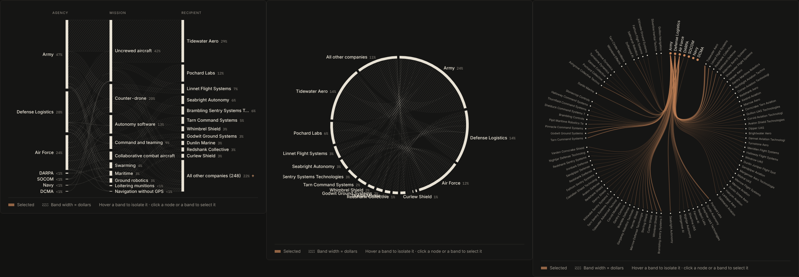
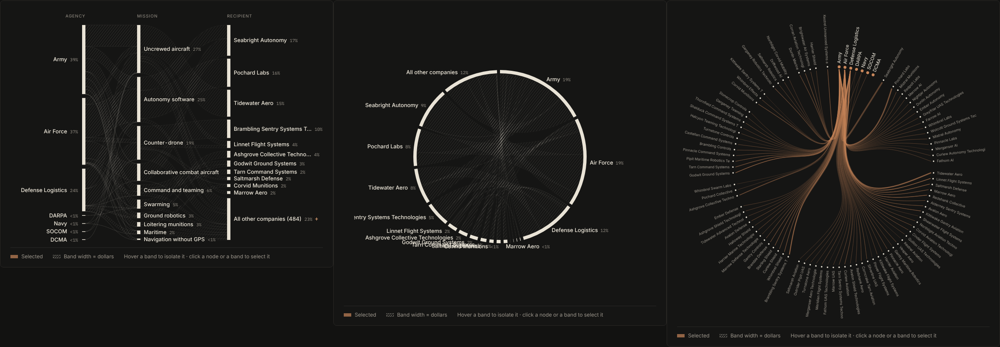

Left to right: Sankey, chord, hierarchical edge bundling.

| Check | Sankey | Chord | Bundled |
| --- | --- | --- | --- |
| 1. Headline in 5s | Yes. The three tallest bars on the left are the three agencies, each with its share printed | No. Every party takes half the circle, so Army's 47% reads as a quarter-turn arc; shares have to be worked out | No. Lines carry no magnitude you can read; the claim is not on the chart |
| 2. Every mark labeled | Yes. Every node is named; the tail is one named node with its count | Partly. Small recipients' names collide at the foot of the circle | Partly. 90 names at 8.5px, rotated; everything past the top 90 is dropped |
| 3. Stays put | Yes. Columns keep the window's ranking; a filter thins them but never reorders | Mostly. Deterministic, but arcs reorder as totals change | Yes |
| 4. 375px | Scrolls sideways inside its frame at 760px; text stays 13px | No. Needs a 560px square plus label margins | No. Needs 600px or more and the labels stop being text |
| 5. Next to the references | Yes: it is Trase's form | Passable | Yes, the handsomest of the three |

**Kept: the Sankey.** It is the only one that shows the middle step (the
mission), the only one where a dollar share can be read off directly, and the
only one that survives a phone. Bundling is the best-looking and the least
legible, and legibility was to be weighed first.

## Constellation: what is one entity connected to

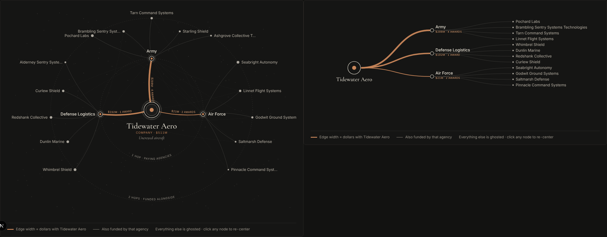
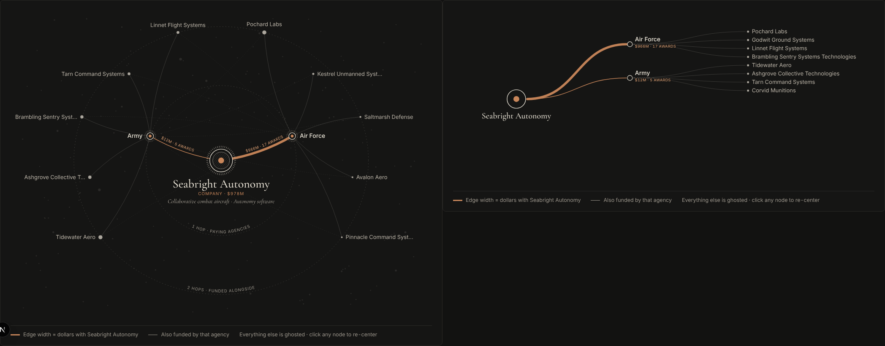

Left: fixed radial rings. Right: a left-to-right fan.

| Check | Rings | Fan |
| --- | --- | --- |
| 1. Who pays it most, in 5s | Yes. Edge width, and the dollars set along the edge | Yes. Same widths, dollars under each name |
| 2. Every mark labeled | Ring 1 always; ring 2 wherever a name has a line's height of arc, the rest on hover. Ghosts name themselves on hover | Yes, every name set flat |
| 3. Stays put | Yes. Positions come from rank; no simulation | Yes |
| 4. 375px | Scrolls sideways inside its frame at 640px | Better: it is nearly a list |
| 5. Next to the references | Yes: Lombardi's arcs on a star chart's rings | No. It reads as an org chart |

**Kept: the rings.** The fan labels better and is kinder to a phone, but it
cannot show the rest of the window ghosted behind the neighborhood, it has no
place for a second tie (a ring-2 company paid by two ring-1 agencies), and it
loses the look the page is built around. The fan's one clear advantage, flat
names, the rings already share: names are set flat and read outward from the
center, never along a radius, and one that would run long is cut with an
ellipsis and spelled out on hover.

## What was not built as a variant

- **Timeline**: ticks and a brush, with a row per mission as the full view.
  A stacked area or a calendar heatmap would hide single awards, which is the
  unit every tick links to.
- **Who leads / activity by mission**: ranked lists with inline bars, as the
  brief's table says. No pie, donut or treemap was tried.

## The finished views

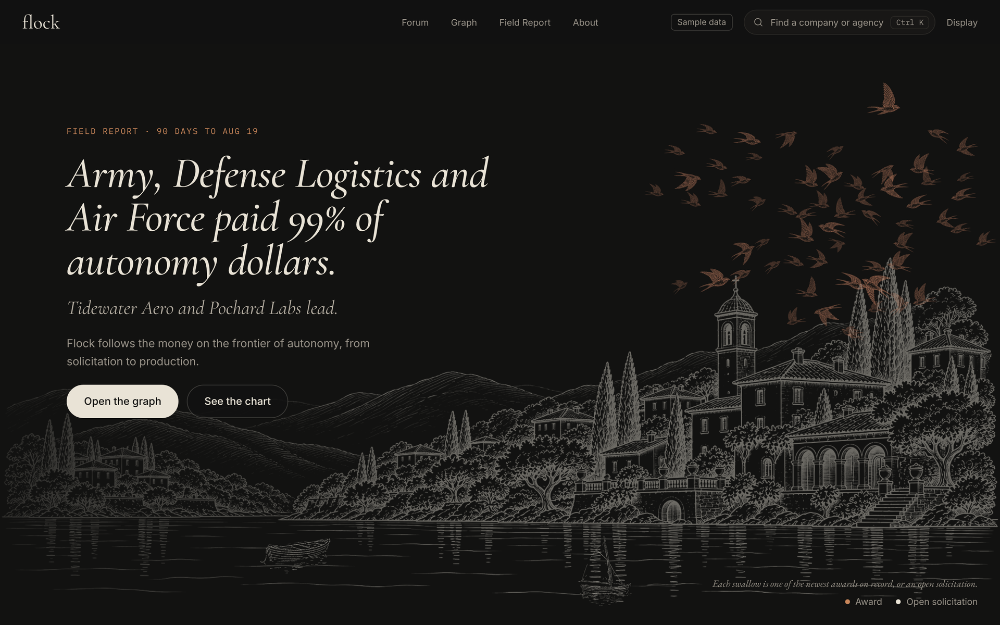
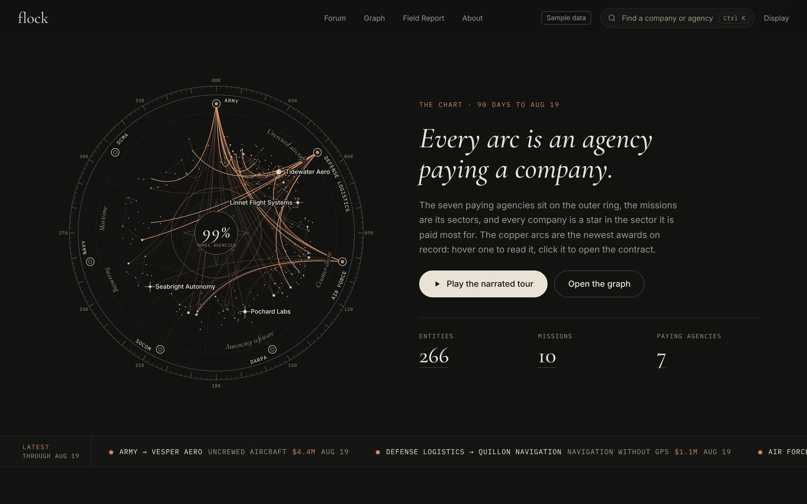
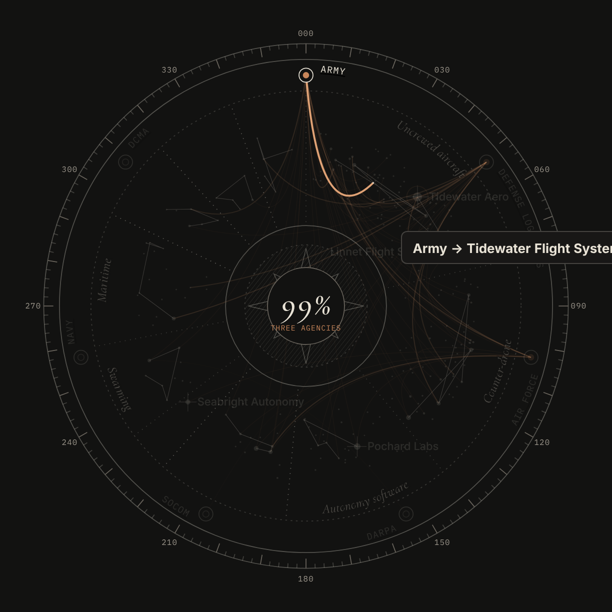
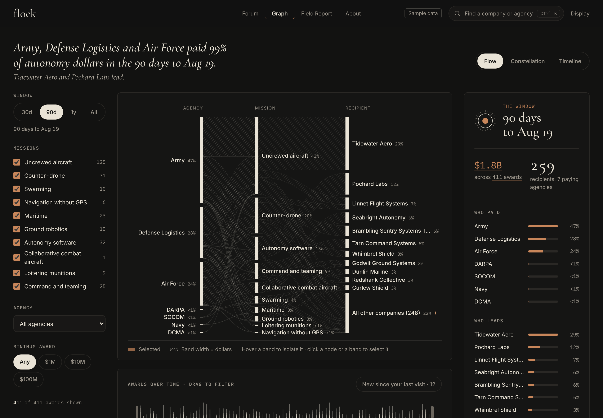
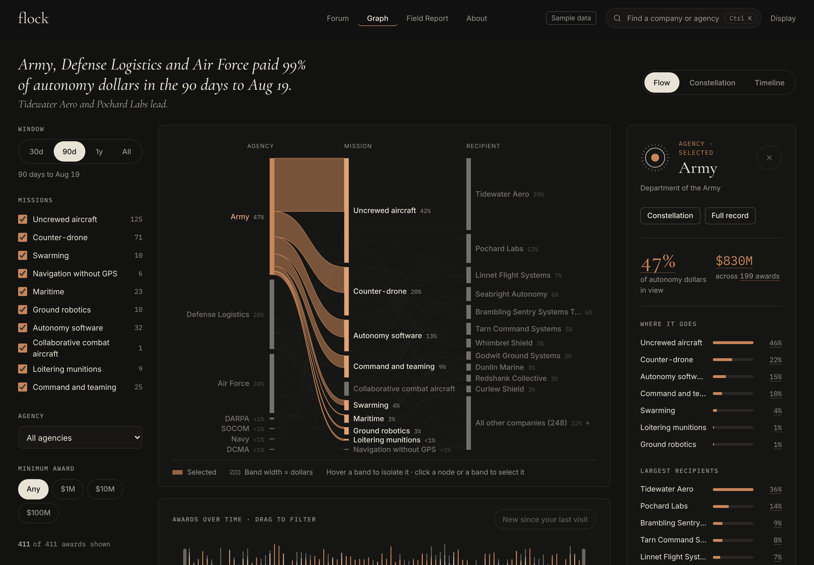
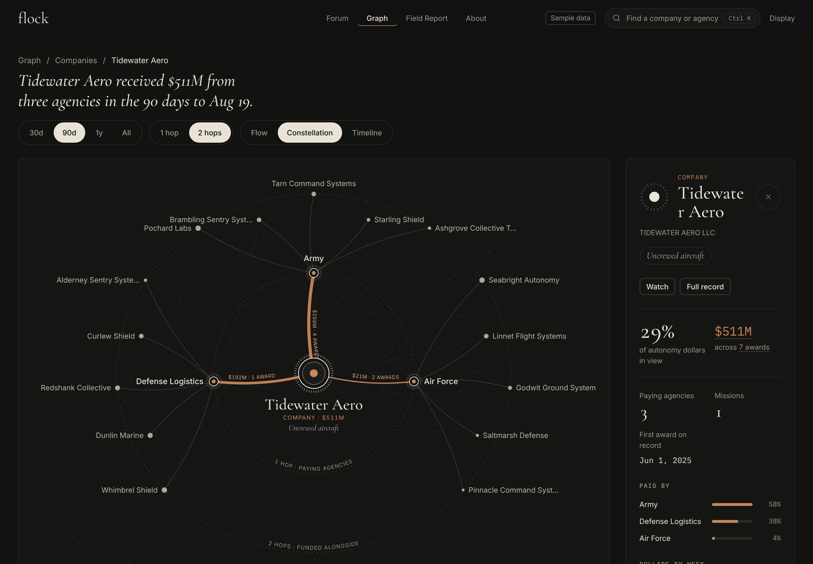
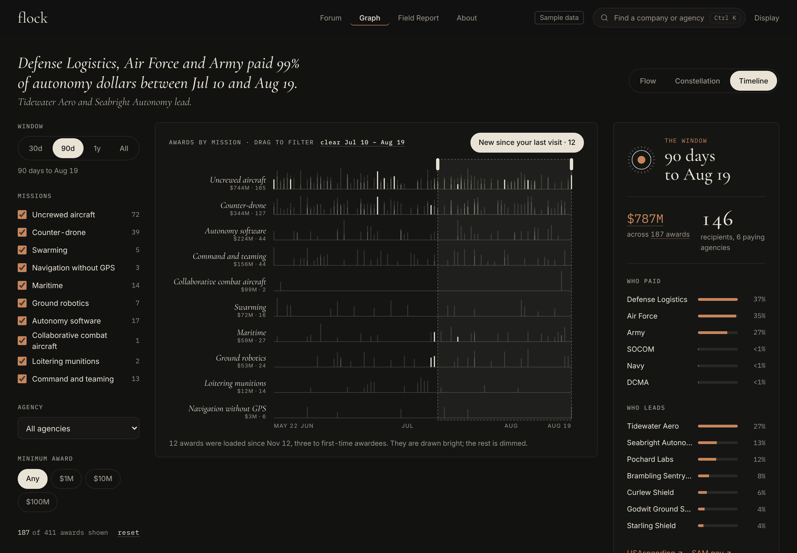
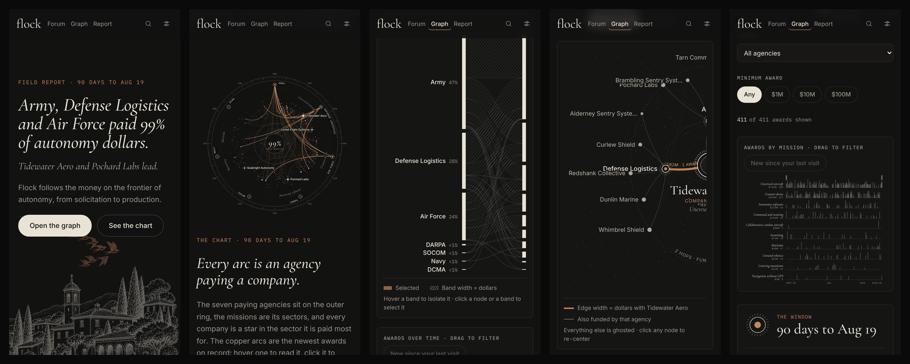
